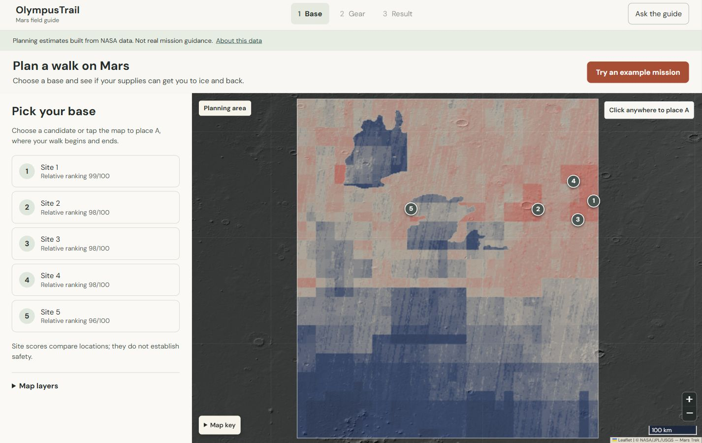

# OlympusTrail



OlympusTrail is a NASA Space Apps hackathon demonstration for exploring a potential Mars walking mission. It compares candidate bases in Arcadia Planitia, plans a round trip to a location with evidence of ice, and estimates oxygen and battery use. Its map and estimates combine observations with models; they are not validated guidance for real missions.

[Try the deployed site](https://olympus-trail.vercel.app/) · [Data sources and credits](frontend/src/sources.js) · [Planner data and methods](data/person1/README.md)

## Run locally

You need Python, Node.js and npm. From the repository root, create a Python environment and install the project dependencies:

```powershell
py -m venv .venv
.\.venv\Scripts\Activate.ps1
python -m pip install -r requirements.txt
npm ci --prefix frontend
```

Start these commands in three separate terminals from the repository root (activate the Python environment in each Python terminal):

```powershell
python -m uvicorn olympustrail.api:app --port 8000
```

```powershell
python -m uvicorn ai_guide.main:app --port 8001
```

```powershell
npm run dev --prefix frontend
```

Open the address printed by Vite, usually http://localhost:5173. Vite forwards planner requests to port 8000 and guide requests to port 8001. The browser smoke test starts Vite automatically; start the planner on port 8000 before running `npm run test:smoke --prefix frontend`. Set `BASE_URL` to target another Vite address. The guide can use its rule-based fallback without an AI key. Optional guide configuration, including provider settings and the explicitly enabled mock mode, is documented in [the guide README](ai_guide/README.md). Keep keys in a local `.env` file and never commit them.

## How it fits together

- `frontend/` contains the React interface, Leaflet Mars map and planner request adapter.
- `olympustrail/` loads the regional raster data, ranks candidate sites and plans routes with oxygen, battery and return reserves.
- `ai_guide/` translates questions into planner requests and explains results; `index.py` exposes the application for the single-origin deployment.

## Data and limits

The planner uses Mars Global Surveyor MOLA terrain, the SWIM ice consistency product, Mars Climate Database scenarios and historical THEMIS observations. The map uses NASA Mars Trek imagery; see the [data source list](frontend/src/sources.js) and [regional manifest](data/person1/arcadia_500m/manifest.json) for details and citations. Measurements, derived layers and modeled conditions have different coverage and resolution; resampling does not create new measurements.

Ice consistency is evidence, not proof of an accessible deposit. Radiation is a uniform reference extrapolated from Gale crater, not a local Arcadia measurement. Shelter candidates are unverified, and walking, oxygen and battery settings are illustrative. A result that fits the chosen budgets is not proof that a mission is safe.

## Checks

```powershell
npm run build --prefix frontend
npm run lint --prefix frontend
node --test frontend/src/api/contract.test.js
```
